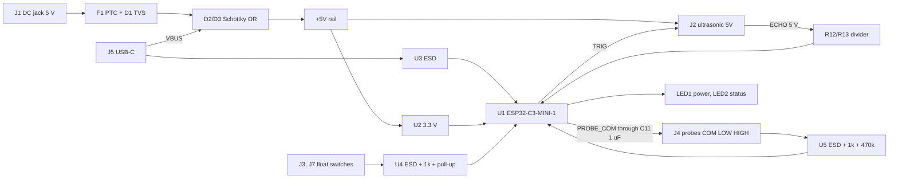

# Tank Sensor Node (ESP32-C3) - project plan (v0, planning only)

Date: 2026-11-05. Working name: **TankPilot** (companion of BorePilot; **name not checked** for collisions, web search was unavailable). Nothing here is drawn or built. You lay out the PCB yourself in EasyEDA: this plan gives the structure, nets, GPIO table, BOM and placement hints only.

## 1. What it is
A small low-cost board that sits at the water tank, reads the level with **whichever sensor you have**, and sends it to BorePilot (ESP-NOW) or to Wi-Fi / MQTT / Home Assistant. One board, three sensor ports, all active at once in firmware (use one, two or all three).

| Port | Sensor | Connector |
|---|---|---|
| ULTRASONIC | JSN-SR04T (waterproof), HC-SR04 / HC-SR04P, A02YYUW-type UART module | J2, 1x4 2.54 header: +5V, TRIG, ECHO, GND |
| FLOAT 1 and FLOAT 2 | any dry-contact float switch (low / full) | J3 and J7, 2P 5.08 screw terminals |
| PROBES | stainless-steel conductive probe kit (the "controller indicator" type: common + low + high probe) | J4, 3P 5.08 screw terminal: COM, LOW, HIGH |
| Power | 5 V DC adapter (barrel jack) or USB-C | J1 DC jack, J5 USB-C |
| Expansion | spare GPIOs, 3V3, 5V (I2C / UART / ADC sensors) | J6, 1x6 header, not fitted by default |

**Assumption to confirm (Q1):** your Amazon link was cut off and I could not open it. I read "Stainless ... Controller Indicator" as a water-level controller with **3 stainless probes** (common, low, high) and a screw-terminal controller. If it is something else (for example a 4-wire controller or a 12/24 V unit), tell me.

## 2. Which MCU: advice
| Option | Price (LCSC) | Wi-Fi / BLE | ESP-NOW | Verdict |
|---|---|---|---|---|
| **ESP32-C3-MINI-1-N4 (C2838502)** | $3.07 | yes / BLE 5 | yes | **Recommended.** Cheapest module that is enough, native USB (no USB-UART chip), enough GPIOs, 3.3 V, certified module with PCB antenna, same ESPHome / Arduino support. |
| ESP32-S3-WROOM-1-N8 (C2913198) | $4.91 | yes / BLE 5 | yes | More CPU, PSRAM options and GPIOs than a tank sensor needs: about +$1.8 per board for nothing here. Use it only if you want one common module with BorePilot. |
| ESP-12F (ESP8266) | about $1 (not looked up) | yes / no BLE | yes | Cheaper, but no native USB, ESP8266 is end-of-line and has 1 ADC pin only: bad for 2 probe inputs. Not recommended. |
| Dev board (C3 SuperMini, ESP32 DevKit) | Rs 200 to 500 in India | yes | yes | Not on the board in v1. A v2 can add two 1x8 sockets "use your own dev board". |

All ports and the pinout below are for the C3-MINI-1. ESP-NOW range and the BorePilot link are the same as in the BorePilot plan (its section 5A).

## 3. Block diagram

## 4. Circuit notes per port (design intent, not verified)
**Ultrasonic (J2).** +5V, TRIG, ECHO, GND. ECHO is a 5 V output on most modules: a 1 k series resistor (R12) and a 2 k resistor to GND (R13) give about 3.3 V at the GPIO. For a 3.3 V sensor such as HC-SR04P, replace R12 by 0 ohm and leave R13 off. TRIG is a 3.3 V output (works with most 5 V modules; test with your JSN-SR04T). A UART-type module (A02YYUW) uses the same two pins as UART RX / TX with the same divider. The sensor is powered from +5V (about 30 mA).
**Float switches (J3, J7).** Each is a dry contact between FLOATn and GND. 10 k pull-up to 3V3 (R4, R5), 1 k series (R8, R9), 100 nF to GND, and a pair of U4's ESD channels (U4 pin 5 to 3V3, pin 2 to GND) so long tank cables cannot kill the GPIO. Firmware reads NO or NC with a software setting.
**Conductive probes (J4).** Water between COM and a probe lets current flow. DC would electrolyse and corrode the probes, so the COM line is driven by a GPIO through a **1 uF series capacitor (C11)**: only AC pulses reach the water, no DC. LOW and HIGH each go through a 1 k series resistor to an ADC pin with a 470 k pull-down; firmware sends bursts (about 1 kHz) on COM and measures the amplitude on LOW and HIGH, so it works from clean to dirty water and ignores hum. U5 protects both lines. **This is a design idea I have not bench-tested** (Q4): the resistor values will need tuning with your probes and your tank water.
**Power.** 5 V from the barrel jack through F1 (0.5 A PTC) and D1 (SMAJ5.0A TVS), or 5 V VBUS from USB-C; D2 / D3 (Schottky) OR them onto +5V, C1 470 uF bulk. U2 (AP2112K-3.3) makes 3.3 V. The C3 draws up to about 0.35 A in Wi-Fi bursts, so the 600 mA part is acceptable here (BorePilot used a bigger LDO for the S3). Do not feed more than 5.5 V into the jack: print "5 V DC ONLY" on the silkscreen.
**USB-C (J5).** Same part as BorePilot (C165948): 5.1 k on CC1 / CC2, D+ / D- through U3 to GPIO19 / GPIO18; native USB programming, no CH340. EN and BOOT buttons for recovery. BOOT also works as the **PAIR** button (hold 3 s after power-up).

## 5. GPIO table (ESP32-C3-MINI-1)
Strapping pins GPIO2, GPIO8, GPIO9 and the USB pins GPIO18 / GPIO19 are not used for sensors (GPIO8 drives only the status LED, GPIO9 is BOOT).

| GPIO | Net | Dir | Notes |
|---|---|---|---|
| 0 | PROBE_LOW | ADC in | ADC1_CH0, 470 k pull-down |
| 1 | PROBE_HIGH | ADC in | ADC1_CH1 |
| 4 | PROBE_COM | out | AC burst through C11 |
| 5 | FLOAT1 | in | pull-up, dry contact |
| 6 | FLOAT2 | in | pull-up, dry contact |
| 7 | US_TRIG | out | to J2 TRIG |
| 10 | US_ECHO | in | from J2 ECHO through the divider |
| 8 | LED_ST | out | green LED2 (strapping pin: LED only, keep it high-impedance at boot) |
| 9 | BOOT / PAIR | in | SW2 to GND |
| 18 / 19 | USB_DN / USB_DP | io | J5 through U3 |
| 3, 20, 21 | EXP1, EXP2, EXP3 | io | J6 expansion header |
| 2 | - | - | not used (strapping) |
| EN | EN | in | SW1, 10 k pull-up, 100 nF |

## 6. BOM (LCSC, looked up 2026-11-05; "verified" = C# matched on the page earlier in the BorePilot work)
Source: [hardware/bom/tank-node-bom-v0.csv](hardware/bom/tank-node-bom-v0.csv). Prices are the lowest tier shown (USD) and change daily; resistor and capacitor counts are estimates.

| Ref | Qty | Function | MPN | LCSC | Stock | Unit $ (tier) | Status |
|---|---|---|---|---|---|---|---|
| U1 | 1 | ESP32-C3 module, 4 MB flash, PCB antenna (default MCU) | ESP32-C3-MINI-1-N4 | [C2838502](https://www.lcsc.com/product-detail/C2838502.html) | 15184 | 3.0672 (1+) | LISTING 2026-11-05 |
| U2 | 1 | 3.3 V LDO 600 mA SOT-25 | AP2112K-3.3TRG1 | [C51118](https://www.lcsc.com/product-detail/C51118.html) | 4510 | 0.1792 (5+) | LISTING (stock from 2026-10-28) |
| U3,U4,U5 | 3 | ESD array: USB D+/D- (U3) and 2 field-input pairs (U4 floats, U5 probes) | USBLC6-2SC6 | [C7519](https://www.lcsc.com/product-detail/C7519.html) | 39325 | 0.1814 (5+) | LISTING (stock from 2026-10-28) |
| J1 | 1 | DC barrel jack 5.5/2.1 mm, 5 V in | DC-005-20A | [C136744](https://www.lcsc.com/product-detail/C136744.html) | 24115 | 0.1398 (5+) | LISTING 2026-11-05; '20A' = 2.0 mm centre pin, 2.1 mm plugs fit - check |
| J5 | 1 | USB-C 16-pin receptacle (programming and 5 V) | TYPE-C-31-M-12 | [C165948](https://www.lcsc.com/product-detail/C165948.html) | 283620 | 0.1886 (5+) | VERIFIED 2026-10-28 (same as BorePilot) |
| F1 | 1 | PTC resettable fuse 0.5 A 6 V, 1206 | 1206L050YR | [C163512](https://www.lcsc.com/product-detail/C163512.html) | 11040 | 0.0742 (10+) | LISTING 2026-11-05; alt ASMD1206-050 C135338 |
| D1 | 1 | TVS 5 V on the supply, SMA | SMAJ5.0A | [C5121739](https://www.lcsc.com/product-detail/C5121739.html) | 1750 | 0.1056 (20+) | LISTING 2026-11-05 (other suppliers); cheaper alt C2991090 at 280+ |
| D2,D3 | 2 | Schottky OR-ing: DC jack and USB VBUS to +5V | UMW SS34B | [C2758511](https://www.lcsc.com/product-detail/C2758511.html) | 77840 | 0.0378 (20+) | LISTING (same as BorePilot) |
| J2 | 1 | 1x4 2.54 header: ultrasonic sensor (5V, TRIG, ECHO, GND) | PZ254V-11-04P | [C2691448](https://www.lcsc.com/product-detail/C2691448.html) | 591680 | 0.0264 (20+) | LISTING (stock from 2026-10-28) |
| J3,J7 | 2 | 2P 5.08 screw terminal x2: float switch 1 (J3) and float switch 2 (J7), dry contact to GND | KF128-5.08-2P-AA | [C474952](https://www.lcsc.com/product-detail/C474952.html) | 51090 | 0.1944 (5+) | LISTING; rating not read |
| J4 | 1 | 3P 5.08 screw terminal: conductive probes (COM, LOW, HIGH) | KF128-5.08-3P-AA | [C474953](https://www.lcsc.com/product-detail/C474953.html) | 8510 | 0.3251 (5+) | LISTING (stock from 2026-10-28) |
| J6 | 1 | 1x6 2.54 header: expansion (5V, 3V3, GND, IO3, IO20, IO21), not fitted by default | PZ254V-11-06P | [C492405](https://www.lcsc.com/product-detail/C492405.html) | 70720 | 0.0410 (20+) | LISTING (stock from 2026-10-28) |
| SW1,SW2 | 2 | Tact switches: EN reset, BOOT / PAIR | TS-1187A-B-A-B | [C318884](https://www.lcsc.com/product-detail/C318884.html) | 887660 | 0.0208 (20+) | LISTING (stock from 2026-10-28) |
| LED1 | 1 | 0603 red LED: power | XL-1608SURC-04 | [C965798](https://www.lcsc.com/product-detail/C965798.html) | 270700 | 0.0057 (100+) | LISTING |
| LED2 | 1 | 0603 green LED: status | 19-217/GHC-YR1S2/6T | [C2986059](https://www.lcsc.com/product-detail/C2986059.html) | 718400 | 0.0180 (50+) | LISTING |
| C1 | 1 | 470 uF 16 V electrolytic 5 V bulk | ERG16V470M8X12 | [C47344174](https://www.lcsc.com/product-detail/C47344174.html) | 64670 | 0.0579 (10+) | LISTING |
| C2,C3,C4 | 3 | 10 uF 1206 (LDO in/out, module 3V3) | CL31A106KAHNNNE | [C9807](https://www.lcsc.com/product-detail/C9807.html) | 493250 | 0.0530 (10+) | VERIFIED listing 2026-10-28 |
| C5-C10 | 6 | 100 nF 1206 decoupling and filter | CL31B104KBCNNNC | [C24497](https://www.lcsc.com/product-detail/C24497.html) | 125980 | 0.0222 (20+) | VERIFIED listing 2026-10-28 |
| C11 | 1 | 1 uF 1206 coupling capacitor on the probe COM line (blocks DC across the water) | CL31B105KBHNNNE | [C1848](https://www.lcsc.com/product-detail/C1848.html) | 147470 | 0.0628 (10+) | LISTING 2026-11-05 |
| R1,R2 | 2 | 5.1 k 1206 USB-C CC1 and CC2 | 1206W4F5101T5E | [C26033](https://www.lcsc.com/product-detail/C26033.html) | 166000 | 0.0050 (100+) | VERIFIED listing |
| R3-R5 | 3 | 10 k 1206: EN pull-up, float pull-ups (2) | 1206W4F1002T5E | [C17902](https://www.lcsc.com/product-detail/C17902.html) | 1059900 | 0.0079 (100+) | VERIFIED listing |
| R6-R12 | 7 | 1 k 1206: LED series (2), float series (2), probe series (2), echo series (1) | 1206W4F1001T5E | [C4410](https://www.lcsc.com/product-detail/C4410.html) | 655650 | 0.0086 (50+) | VERIFIED listing; count estimated |
| R13 | 1 | 2 k 1206: echo divider lower leg (5 V to 3.3 V) | 1206W4F2001T5E | [C17944](https://www.lcsc.com/product-detail/C17944.html) | 1321900 | 0.0078 (100+) | LISTING 2026-11-05 |
| R14,R15 | 2 | 470 k 1206: probe line pull-downs (LOW, HIGH) | 1206W4F4703T5E | [C17997](https://www.lcsc.com/product-detail/C17997.html) | 9000 | 0.0074 (100+) | LISTING 2026-11-05; value to tune on the bench |

**Rough parts total: about USD 5.8** (46 pieces, PCB and sensors not included). Sensors you supply: JSN-SR04T about Rs 400 to 600, float switch about Rs 100 to 300, the probe kit (your Amazon item), a 5 V adapter.

## 7. PCB size and placement hints (for your EasyEDA layout)
- **Size: 60 x 45 mm, 2 layers, 1.6 mm, 1 oz.** Four M3 holes, 3.2 mm, non-plated, 4 mm from the corners. This stays far under the 100 x 100 mm cheapest-tier limit.
- **Edges:** left edge J1 (DC jack) and J5 (USB-C); top edge J2 (ultrasonic header) and J6; bottom edge J3, J7, J4 (screw terminals, cable entry downward). Module U1 at the right edge with its **antenna end over the board edge or a copper keep-out under it** (ESP32-C3-MINI-1 has a PCB antenna): nothing under the antenna.
- **Silkscreen:** one dashed box per port with its title (ULTRASONIC, FLOAT 1, FLOAT 2, PROBES, POWER, USB) like the BorePilot guide; label every terminal pin (COM, LOW, HIGH, F, GND, 5V, TRIG, ECHO) and "5 V DC ONLY" at the jack.
- **Placement:** U2 and its capacitors next to C1; F1, D1, D2 and D3 between the jack and C1; U3 close to J5; U4 and U5 close to their terminals; R12 / R13 near U1's echo pin; decoupling caps next to U1's 3V3 pin.
- **Water and outdoors:** put the board in a plastic IP65 box near the tank; conformal coating recommended; keep probe and float cables away from the antenna.

## 8. Firmware plan (ESPHome, later)
ESPHome `esp32` (board `esp32-c3-devkitm-1`, esp-idf): `ultrasonic` sensor on GPIO7 / GPIO10 (long timeout for the JSN-SR04T), `binary_sensor` for the floats, probe bursts through a small custom component, ESP-NOW to BorePilot (message: level %, state LOW / MID / FULL, sensor in use, link OK), fallback Wi-Fi / MQTT. **Unverified:** ESPHome ESP-NOW support on both ends and the probe-burst code.

## 9. Phases
0 answer section 10 and check the name -> 1 read datasheets (C3-MINI-1, AP2112K, DC-005 jack, KF128, USBLC6) -> 2 schematic in EasyEDA (one page per block) -> 3 footprint check -> 4 layout by you (silkscreen boxes) -> 5 firmware -> 6 bench test with a bucket: ultrasonic distance vs a ruler, floats, probe amplitudes in clean and salty water -> 7 order 5 boards.

## 10. Open questions
| # | Question | Default |
|---|---|---|
| Q1 | What exactly is the Amazon probe terminal (3 stainless probes + controller)? Please paste the full link or the product title. | 3 probes: COM, LOW, HIGH |
| Q2 | Is a 4th probe (MID) wanted? | no (3P terminal) |
| Q3 | Which ultrasonic module(s) do you own: JSN-SR04T, HC-SR04, A02YYUW? | support all three |
| Q4 | OK that the probe circuit is untested and may need resistor changes? | yes, bench-tune |
| Q5 | Power only from the 5 V adapter, or also battery / solar later? | adapter + USB only |
| Q6 | Name: TankPilot or another? (collision check still to do) | working name |
| Q7 | Does the node talk to BorePilot (ESP-NOW), to Home Assistant, or both? | both |
| Q8 | A v2 with sockets for your own dev board wanted? | not in v1 |

## 11. Unverified items
No datasheet read yet for: ESP32-C3-MINI-1, AP2112K (reused from an earlier list), DC-005-20A (centre-pin size), KF128 terminals (rating), SMAJ5.0A, 1206L050YR, USBLC6 as a 3.3 V-referenced clamp, JSN-SR04T trigger and echo levels, the probe circuit values. Prices and stock are page values from 2026-11-05 or 2026-10-28. No footprint compared. Mains is not involved, but long cables into outdoor tanks need ESD and lightning care.
