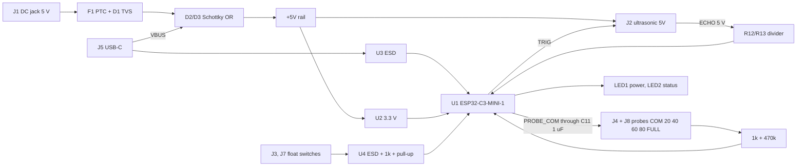

# Tank Sensor Node (ESP32-C3) - project plan (v0, planning only)

Date: 2026-11-05. Working name: **TankPilot** (companion of BorePilot; **name not checked** for collisions, web search was unavailable). Nothing here is drawn or built. You lay out the PCB yourself in EasyEDA: this plan gives the structure, nets, GPIO table, BOM and placement hints only.

## 1. What it is
A small low-cost board that sits at the water tank, measures the water level in % with **whichever sensor you have** (ultrasonic, five-level probes, float; automatic fallback if one fails) and reports it to **Home Assistant through ESPHome (Wi-Fi)**. It is a **separate, stand-alone board: nothing in the BorePilot project changes.** A Home Assistant automation then starts the pump (using BorePilot's existing Start Pump switch) when the level falls below a set % (for example 20 %) and stops it when the tank is full. See section 8. One board, three sensor ports, all active at once in firmware (use one, two or all three).

| Port | Sensor | Connector |
|---|---|---|
| ULTRASONIC | JSN-SR04T (waterproof), HC-SR04 / HC-SR04P, A02YYUW-type UART module | J2, 1x4 2.54 header: +5V, TRIG, ECHO, GND |
| FLOAT 1 and FLOAT 2 | any dry-contact float switch (low / full) | J3 and J7, 2P 5.08 screw terminals |
| PROBES | stainless-steel conductive probe kit: **COM (bottom reference) + 5 level probes at 20 %, 40 %, 60 %, 80 % and FULL** | J4 and J8, two 3P 5.08 screw terminals side by side: J4 = COM, 20 %, 40 %; J8 = 60 %, 80 %, FULL |
| Power | 5 V DC adapter (barrel jack) or USB-C | J1 DC jack, J5 USB-C |
| Expansion | spare GPIO, 3V3, 5V | J6, 1x4 header (5V, 3V3, GND, IO2 = DHT11 line), not fitted by default |

**Your probe kit (Q1, answered 2026-11-05):** Imagine Technologies stainless steel sensors, 5 probes with coloured wires about 1.5 m long, Rs 299 (part IT05SS, Amazon B0GT55JTZR, page read 2026-11-05). Listed for 25 / 50 / 75 / 100 % levels. With 5 probes you use **COM + 4 levels (25, 50, 75, 100 %)**; the fifth level terminal stays empty (firmware: not fitted). A 3-probe pack (Rs 199) would give the full 20/40/60/80/FULL. Wire gauge not stated: check on arrival; join a longer cable if the box is not next to the tank.

## 2. Which MCU: advice
| Option | Price (LCSC) | Wi-Fi / BLE | ESP-NOW | Verdict |
|---|---|---|---|---|
| **ESP32-C3-MINI-1-N4 (C2838502)** | $3.07 | yes / BLE 5 | yes | **Recommended.** Cheapest module that is enough, native USB (no USB-UART chip), enough GPIOs, 3.3 V, certified module with PCB antenna, same ESPHome / Arduino support. |
| ESP32-S3-WROOM-1-N8 (C2913198) | $4.91 | yes / BLE 5 | yes | More CPU, PSRAM options and GPIOs than a tank sensor needs: about +$1.8 per board for nothing here. Use it only if you want one common module with BorePilot. |
| ESP-12F (ESP8266) | about $1 (not looked up) | yes / no BLE | yes | Cheaper, but no native USB, ESP8266 is end-of-line and has 1 ADC pin only: bad for 2 probe inputs. Not recommended. |
| Dev board (C3 SuperMini, ESP32 DevKit) | Rs 200 to 500 in India | yes | yes | Not on the board in v1. A v2 can add two 1x8 sockets "use your own dev board". |

All ports and the pinout below are for the C3-MINI-1. The node talks to Home Assistant over Wi-Fi (ESPHome native API); ESP-NOW is not needed.

## 3. Block diagram

## 4. Circuit notes per port (design intent, not verified)
**Ultrasonic (J2).** +5V, TRIG, ECHO, GND. ECHO is a 5 V output on most modules: a 1 k series resistor (R12) and a 2 k resistor to GND (R13) give about 3.3 V at the GPIO. For a 3.3 V sensor such as HC-SR04P, replace R12 by 0 ohm and leave R13 off. TRIG is a 3.3 V output (works with most 5 V modules; test with your JSN-SR04T). A UART-type module (A02YYUW) uses the same two pins as UART RX / TX with the same divider. The sensor is powered from +5V (about 30 mA).
**Your sensor (JSN-SR04T type, Robocraze page read 2026-11-05):** 5 V supply, TRIG / ECHO, range 25 to 450 cm, 40 kHz, IP67 probe on a cable. Two consequences for the tank: (1) the **blind zone is 25 cm**, so mount the probe at least 25 cm above the highest water level, pointing straight down at the water; (2) ECHO is 5 V, so the R12 / R13 divider is needed (that is what the board has). The product page does not give the trigger voltage; a 3.3 V TRIG usually works but test it.
**Float switch (J3).** A dry contact between FLOAT1 and GND (the second float input was removed 2026-11-05 to free GPIO10 for the DHT11). 10 k pull-up to 3V3 (R4), 1 k series (R8), 100 nF to GND, and one of U4's ESD channels (U4 pin 5 to 3V3, pin 2 to GND) so long tank cables cannot kill the GPIO. Firmware reads NO or NC with a software setting.
**Your float switch (HYDRO FLOW automatic water level controller float switch, Rs 689, Amazon page read 2026-11-05):** a single cable float with a 3 m wire, sold to switch a pump motor ON when the tank is low and OFF when it is full. It is built for mains pump wiring, so: (1) use it **only as a dry contact on J3 (FLOAT 1)**: its two wires go to the terminal and nothing else; never connect the same contact to the pump or to mains at the same time; (2) it gives one level (full or low, set by how it hangs and the NO / NC choice in firmware); the five-probe kit or the ultrasonic sensor gives the intermediate levels; (3) the 3 m cable is fine with the 1 k / 100 nF / ESD input, polarity does not matter; (4) the page does not say whether the cable has 2 or 3 wires or its contact rating: check the wires with a meter. J7 (FLOAT 2) stays free for a second float.
**Conductive probes (J4 + J8).** The kit has 6 wires: COM at the bottom of the tank and five level probes at 20 %, 40 %, 60 %, 80 % and FULL. Water between COM and a probe lets current flow. DC would electrolyse and corrode the probes, so COM is driven by a GPIO through a **1 uF series capacitor (C11)**: only AC pulses reach the water, no DC. Each of the five probe lines goes through a 1 k series resistor to a **digital GPIO input with a 470 k pull-down**; firmware sends short bursts (about 1 kHz) on COM and samples each probe line during the burst, so a wet probe follows the pulses and a dry one stays low. The level is the highest wet probe (for example 60 % wet and 80 % dry = 60 to 80 %), with a debounce of a few seconds against slosh. U5 to U7 (ESD, optional, can be left off if the cables are short and inside the box) protect the six lines. With 470 k pull-downs, water up to about 100 k between COM and a probe still gives more than 2.7 V. **This is a design idea I have not bench-tested** (Q4): the resistor values will need tuning with your probes and your tank water; the probe terminals must stay out of any mains wiring.
**Power.** 5 V from the barrel jack through F1 (0.5 A PTC) and D1 (SMAJ5.0A TVS), or 5 V VBUS from USB-C; D2 / D3 (Schottky) OR them onto +5V, C1 470 uF bulk. U2 (AP2112K-3.3) makes 3.3 V. The C3 draws up to about 0.35 A in Wi-Fi bursts, so the 600 mA part is acceptable here (BorePilot used a bigger LDO for the S3). Do not feed more than 5.5 V into the jack: print "5 V DC ONLY" on the silkscreen.
**USB-C (J5).** Same part as BorePilot (C165948): 5.1 k on CC1 / CC2, D+ / D- through U3 to GPIO19 / GPIO18; native USB programming, no CH340. EN and BOOT buttons for recovery. BOOT also works as the **PAIR** button (hold 3 s after power-up).

## 5. GPIO table (ESP32-C3-MINI-1)
Strapping pins GPIO2, GPIO8, GPIO9 and the USB pins GPIO18 / GPIO19 are avoided for sensors (GPIO8 drives only the status LED, GPIO9 is BOOT, GPIO2 is the DHT11 line (idles high)). GPIO11 to GPIO17 are used by the module's flash and are not available.

| GPIO | Net | Dir | Notes |
|---|---|---|---|
| 4 | PROBE_COM | out | AC burst through C11 |
| 0 | LDR | in (ADC1 ch0) | LDR on J11: 1 k series, 10 k pull-up to 3V3, 100 nF (not a strapping pin) |
| 1 | PROBE_40 | in | same |
| 3 | PROBE_60 | in | same |
| 5 | PROBE_80 | in | same |
| 6 | PROBE_FULL | in | same |
| 7 | FLOAT1 | in | pull-up, dry contact |
| 10 | PROBE_20 | in | 470 k pull-down, 1 k series |
| 20 | US_ECHO | in | from J2 ECHO through the divider (RXD0 pin 30) |
| 21 | US_TRIG | out | to J2 TRIG (TXD0 pin 31; USB is used for logs) |
| 8 | LED_ST | out | green LED2 (strapping pin: LED only) |
| 9 | BOOT / PAIR | in | SW2 to GND |
| 18 / 19 | USB_DN / USB_DP | io | J5 through U3 |
| 2 | DHT | io | DHT11 data on J12, 10 k pull-up (also J6 pin 4). Strapping pin: must be high at reset (data sheet table 6): the DHT11 idles high through the pull-up |
| EN | EN | in | SW1, 10 k pull-up, 100 nF |

All 15 usable GPIOs are assigned. A UART-type ultrasonic module (A02YYUW) uses GPIO20 / GPIO21 as UART1 pins remapped in firmware.

## 6. BOM (LCSC, looked up 2026-11-05)
Source: [hardware/bom/tank-node-bom-v1.csv](hardware/bom/tank-node-bom-v1.csv); the BOM page is [docs/bom.html](docs/bom.html) and [hardware/bom/bom-table.md](hardware/bom/bom-table.md). **65 pieces, about USD 9.84 in total; about USD 6.19 without the optional HLK 230 V block** (PCB and sensors not included). Stock and prices change daily.

Power now has **three sources (the DC jack J1 or the 2-pin screw terminal J10 for 5 V DC, USB-C, or the optional HLK), OR-ed with Schottky diodes D2 / D3 / D4**: 5 V DC jack J1 (PTC F1 + TVS D1), USB-C J5 (VBUS), and the **optional HLK-5M05 (230 V AC to 5 V, U8)** with its fuse F2, varistor RV1 and AC terminal J9. The HLK block is DNP by default. It is a **mains circuit next to a water tank: engineer review required before any build**; the datasheet asks for a 0.5 A slow fuse and a 10D561K varistor, the board has a milled isolation slot, and the box must be IP65 with the mains part separated from the probe wiring.

| Refs | Qty | Function | LCSC | Stock | Unit $ (tier) | Status |
|---|---|---|---|---|---|---|
| J1 | 1 | DC barrel jack 5.5/2.1 mm: external 5 V in | [C136744](https://www.lcsc.com/product-detail/C136744.html) DC-005-20A | 24115 | 0.1398 (5+) | LISTING 2026-11-05; 2.0 mm centre pin variant, 2.1 mm plugs fit: check |
| J10, J9, J3, J11 | 4 | 5 V DC screw terminal 2P (+5 V / Float switch terminal 2P (dry contact) / LDR screw termin | [C474952](https://www.lcsc.com/product-detail/C474952.html) KF128-5.08-2P-AA | 51090 | 0.1944 (5+) | LISTING; rating not read |
| F1 | 1 | PTC fuse 0.5 A 6 V, 1206 | [C163512](https://www.lcsc.com/product-detail/C163512.html) 1206L050YR | 11040 | 0.0742 (10+) | LISTING 2026-11-05; alt ASMD1206-050 C135338 |
| D1 | 1 | TVS 5 V (SMAJ5.0A) across the supply | [C5121739](https://www.lcsc.com/product-detail/C5121739.html) SMAJ5.0A | 1750 | 0.1056 (20+) | LISTING 2026-11-05 (other suppliers); cheaper alt C2991090 at 280+ |
| D2, D3, D4 | 3 | OPTIONAL Schottky OR-ing: HLK to +5V / Schottky OR-ing: DC jack to +5V / Schottky OR-ing:  | [C2758511](https://www.lcsc.com/product-detail/C2758511.html) UMW SS34B | 77840 | 0.0378 (20+) | LISTING (same as BorePilot) |
| C1 | 1 | 470 uF 16 V bulk on +5V | [C47344174](https://www.lcsc.com/product-detail/C47344174.html) ERG16V470M8X12 | 64670 | 0.0579 (10+) | LISTING |
| U2 | 1 | AP2112K-3.3 LDO, SOT-25 | [C51118](https://www.lcsc.com/product-detail/C51118.html) AP2112K-3.3TRG1 | 4510 | 0.1792 (5+) | LISTING (stock from 2026-10-28) |
| C2, C3, C4 | 3 | 10 uF 1206 | [C9807](https://www.lcsc.com/product-detail/C9807.html) CL31A106KAHNNNE | 493250 | 0.0530 (10+) | VERIFIED listing 2026-10-28 |
| C5, C6, C7, C8, C9, C10, C14, C12, C15 | 9 | 100 nF 1206 / 100 nF 1206 on +5V / 100 nF 1206 on VBUS / 100 nF 1206 on the sensor +5V / O | [C24497](https://www.lcsc.com/product-detail/C24497.html) CL31B104KBCNNNC | 125980 | 0.0222 (20+) | VERIFIED listing 2026-10-28 |
| F2 | 1 | OPTIONAL fuse 0.5 A slow-blow 5x20 (ships separately) | [C142727](https://www.lcsc.com/product-detail/C142727.html) 0218.500MXP | 900 | 0.2257 (5+) | LISTING 2026-10-28; 0.5 A slow-blow 5x20, HLK datasheet value |
| F2H | 2 | OPTIONAL 5x20 fuse clips (2 pieces) | [C3131](https://www.lcsc.com/product-detail/C3131.html) BLX-A XC-7 | 85140 | 0.0854 (5+) | LISTING 2026-10-28; 2 clips per fuse, rating to confirm |
| RV1 | 1 | OPTIONAL varistor 560 V (10D561K) across L-N | [C2839517](https://www.lcsc.com/product-detail/C2839517.html) 10D561K | 38910 | 0.0494 (10+) | LISTING 2026-10-28; varistor value from the HLK datasheet |
| U8 | 1 | OPTIONAL HLK-5M05 AC-DC 5 V 1 A module | [C209907](https://www.lcsc.com/product-detail/C209907.html) HLK-5M05 | 3052 | 2.9474 (1+) | VERIFIED + datasheet read (BorePilot work); 38 x 23 x 18 mm, 90-265 VAC, 3000 VAC isolation |
| J5 | 1 | USB-C 16-pin receptacle (programming and 5 V) | [C165948](https://www.lcsc.com/product-detail/C165948.html) TYPE-C-31-M-12 | 283620 | 0.1886 (5+) | VERIFIED 2026-10-28 (same as BorePilot) |
| U3, U4 | 2 | USBLC6-2SC6 ESD for the float line (second channel unused) / USBLC6-2SC6 ESD on USB D+/D- | [C7519](https://www.lcsc.com/product-detail/C7519.html) USBLC6-2SC6 | 39325 | 0.1814 (5+) | LISTING (stock from 2026-10-28) |
| R1, R2 | 2 | 5.1 k 1206 | [C26033](https://www.lcsc.com/product-detail/C26033.html) 1206W4F5101T5E | 166000 | 0.0050 (100+) | VERIFIED listing |
| U1 | 1 | ESP32-C3-MINI-1-N4 module | [C2838502](https://www.lcsc.com/product-detail/C2838502.html) ESP32-C3-MINI-1-N4 | 15184 | 3.0672 (1+) | LISTING 2026-11-05; datasheet v1.7 pin table read |
| SW1, SW2 | 2 | BOOT / PAIR button (GPIO9) / Reset button (EN) | [C318884](https://www.lcsc.com/product-detail/C318884.html) TS-1187A-B-A-B | 887660 | 0.0208 (20+) | LISTING (stock from 2026-10-28) |
| R3, R4, R22, R23 | 4 | 10 k 1206 | [C17902](https://www.lcsc.com/product-detail/C17902.html) 1206W4F1002T5E | 1059900 | 0.0079 (100+) | VERIFIED listing |
| LED1 | 1 | Red LED: power (3.3 V) | [C965798](https://www.lcsc.com/product-detail/C965798.html) XL-1608SURC-04 | 270700 | 0.0057 (100+) | LISTING (red, inferred from name) |
| R6, R7, R15, R8, R24, R10, R11, R12, R13, R14 | 10 | 1 k 1206 | [C4410](https://www.lcsc.com/product-detail/C4410.html) 1206W4F1001T5E | 655650 | 0.0086 (50+) | VERIFIED listing |
| LED2 | 1 | Green LED: status (GPIO8) | [C2986059](https://www.lcsc.com/product-detail/C2986059.html) 19-217/GHC-YR1S2/6T | 718400 | 0.0180 (50+) | LISTING (green, inferred from name) |
| J6, J2 | 2 | OPTIONAL expansion header 1x4 (5V / Ultrasonic sensor header 1x4 (JSN-SR04T / HC-SR04) | [C2691448](https://www.lcsc.com/product-detail/C2691448.html) PZ254V-11-04P | 591680 | 0.0264 (20+) | LISTING (stock from 2026-10-28) |
| R16 | 1 | 2 k 1206, ECHO divider to GND | [C17944](https://www.lcsc.com/product-detail/C17944.html) 1206W4F2001T5E | 1321900 | 0.0078 (100+) | LISTING 2026-11-05 |
| J12 | 1 | DHT11 header 1x3 (3V3, DATA, GND) | [C492402](https://www.lcsc.com/product-detail/C492402.html) PZ254V-11-03P | not read | 0.0200 (20+) | LISTING 2026-11-05 (1x3 header; stock and price not shown on the page, price estimated from the 4P part) |
| J4, J8 | 2 | Probe terminal 3P: 60 % / Probe terminal 3P: COM | [C474953](https://www.lcsc.com/product-detail/C474953.html) KF128-5.08-3P-AA | 8510 | 0.3251 (5+) | LISTING (stock from 2026-10-28); no 6P part on LCSC |
| C11 | 1 | 1 uF 1206 coupling capacitor on PROBE_COM (no DC in the water) | [C1848](https://www.lcsc.com/product-detail/C1848.html) CL31B105KBHNNNE | 147470 | 0.0628 (10+) | LISTING 2026-11-05 |
| R17, R18, R19, R20, R21 | 5 | 470 k 1206 | [C17997](https://www.lcsc.com/product-detail/C17997.html) 1206W4F4703T5E | 9000 | 0.0074 (100+) | LISTING 2026-11-05; value to tune on the bench |

## 7. PCB size and placement (for your EasyEDA layout)
- **Size: 94 x 70 mm with the HLK 230 V block (about 72 x 70 mm if you leave that block out), 2 layers, 1.6 mm, 1 oz.** Three M3 holes, non-plated. Under the 100 x 100 mm limit and sized for the **120 x 80 x 55 mm IP67 transparent ABS enclosure** (IDIS India SKU 10188): about 96 x 75 mm of free floor between the lid-screw posts and side bosses, about 43 mm inside height, so a 100 mm wide board would not fit. Use the J10 screw terminal for 5 V (the box is sealed), cable glands for the sensor wires, and confirm the PCB mounting posts on the real box. The DWG drawing could not be opened on this PC (no CAD reader); dimensions come from the data-sheet image.
- **Thirteen silkscreen blocks**, each part inside its own rectangle (ULTRASONIC, FLOAT SWITCH, DHT11, 5 V POWER, 5 V IN TERMINAL, LDR, USB-C, PROBES, ESP32-C3, EXPANSION, HLK 5V OUT, HLK 230 V, AC IN 230 V): see [docs/pcb-floorplan.html](docs/pcb-floorplan.html) with X / Y tables and the checked floor plan (planning estimates, not EasyEDA footprints; checker reports 0 problems).
- Mains zone on the right, isolation slot (1.3 mm) at x 72.4 to 73.7, y 1.5 to 67, low-voltage parts at least 3.2 mm from the mains-only parts; U1 antenna end at the top edge with nothing above it.
- Other pages: [wiring](docs/wiring-by-section.html), [schematic](docs/schematic-sections.html).
- **Water and outdoors:** plastic IP65 box near the tank; conformal coating recommended; keep probe and float cables away from the antenna.

## 7b. Extra ports added 2026-11-05
- **J10:** 2-pin screw terminal for an external 5 V supply (in addition to the DC jack J1; same net, use one at a time).
- **Probes:** two 3-pin terminals J4 + J8 = 6 wires (COM + 5 levels). The 5-probe kit you chose uses COM + 4 of them.
- **J11 + R22 / R24 / C15:** LDR (light sensor) on a 2-pin terminal, read by the ADC on GPIO0.
- **J12 + R23:** DHT11 on a 1x3 header (3V3, DATA, GND) on GPIO2. **Check the pin order of your DHT11 board** before ordering.
- **Trade-off:** all usable GPIOs were already used, so the **second float input (FLOAT2 / old J7) was removed** to free a GPIO. One float input remains (J3). **Pin swap 2026-11-06:** GPIO2 must be high at reset, so the LDR (which can pull low in bright light) moved to GPIO0 (ADC), PROBE_20 moved to GPIO10 and the DHT11 (idles high) took GPIO2.

## 8. Level measurement, auto-start logic, Home Assistant and display (requirements from 2026-11-05)

**What you asked for.** Measure the water level in % with a probe kit **or** an ultrasonic sensor (you buy either one, or both); when the water falls below a set level (for example below 20 %) the pump starts by itself and stops when the tank is full; everything is controlled from Home Assistant through ESPHome; the level may also be shown on the BorePilot display later (optional, see 8.5); if the ultrasonic sensor ever fails, the board must carry on with the probes (you said you would use the probe if the ultrasonic is unreliable).

**Scope (2026-11-05): the tank board is a separate extra board; the BorePilot project is not changed.** The tank node talks only to Home Assistant (ESPHome native API over Wi-Fi). It already has everything for this requirement; the rest is firmware.

**Hardware answer:** the board already has three independent level sources (ultrasonic, five-level probes, float). Nothing more is needed for this requirement; it is firmware logic.

### 8.1 Which sensor to buy (advice)
| | Ultrasonic (JSN-SR04T, Rs 345) | 5-level probes (stainless) |
|---|---|---|
| Output | smooth % (centimetre accuracy) | 5 steps: 20, 40, 60, 80, FULL |
| Good for | showing a nice level bar, trends | auto-start at a level, overflow stop, very reliable |
| Weak point | 25 cm blind zone at the top; steam, condensation, foam and a dirty probe face give no reading or noise | probes foul or corrode over months; water must be conductive; needs 6 wires down the tank |
| Mounting | on the tank lid, facing down | rods hanging from the lid, COM longest |
Buy one of them now: for **auto-start at 20 %** the probes are the safer main sensor; the ultrasonic is nicer for a percentage display. The board supports both together, so you can add the other later.

### 8.2 Level calculation and fallback (firmware logic)
1. **Ultrasonic %** = (D_empty - distance) / (D_empty - D_full), clamped 0 to 100. D_empty and D_full are set once in Home Assistant (D_full at least 25 cm because of the blind zone).
2. **Probe level** = highest wet probe: 0 (none), 20, 40, 60, 80, 100 %; a band is reported as "between X and Y %".
3. **Sensor mode** (Home Assistant select): Auto (default), Ultrasonic only, Probes only, Float only.
4. **Auto rules:**
   - Ultrasonic is *healthy* when it returns a valid reading in at least 8 of the last 10 shots, inside the range 25 to 450 cm, with small noise.
   - Probes are *healthy* when the readings are consistent (a wet probe above a dry one is inconsistent) and COM drives properly.
   - Both healthy: use the ultrasonic % for display and the **probe steps as a safety cross-check**; if they disagree by more than 25 points for 60 s, trust the probes for pump decisions and raise a "sensor disagree" alert.
   - Ultrasonic unhealthy: use the probes (the case you described), raise "ultrasonic failed" in Home Assistant.
   - Both unhealthy: use the float if present; otherwise **do not start the pump automatically** and raise an alert.
5. **Source indicator** is always sent with the level (ULTRASONIC, PROBES, FLOAT, NONE) so you always see what is being used.

### 8.3 Pump control (who decides): Home Assistant, no change on BorePilot
- The tank node only measures and reports. **Home Assistant decides**, with an automation that uses the entities BorePilot already has (`Start Pump`, `Stop Pump`, `Pump Amps`, `Pump Running Status`).
- **Start** when `Tank level %` < `start_below` (default 20 %, any value you set in Home Assistant) **and** the tank data is fresh **and** the pump is off, a minimum off time has passed (default 5 min) and no alarm is active: press `Start Pump` (BorePilot pulses its start relay as it does today).
- **Stop** when the level reaches `stop_at` (default FULL / 100 %) or the float says full: press `Stop Pump`. Also stop after a maximum run time (default 60 min). BorePilot's own dry-run protection stays as it is.
- **Stale or unavailable data:** if the tank node is `unavailable` for more than 2 minutes, the automation never starts the pump and sends a notification.
- **Manual override:** an input_boolean `Tank auto mode` in Home Assistant turns the automation on or off; BorePilot's physical buttons keep working.
- **If Home Assistant is down** the pump is simply not started automatically (same as having no automation). If you later want a fully offline auto-start, a small option is to run the same rules inside the tank node and give it its own relay output: not in v1.
- Home Assistant automation example (YAML) will be added to `docs/` when you confirm the entity names.

### 8.4 Home Assistant (ESPHome) entities
Tank node: `Tank level %` (sensor), `Tank level source`, `Ultrasonic distance cm`, `Probe 20 / 40 / 60 / 80 / FULL` (binary sensors), `Float 1`, `Ultrasonic OK`, `Probes OK`, `Sensor mode` (select), `D_empty cm`, `D_full cm` (numbers), `Node link OK`.
Home Assistant helpers (created in Home Assistant, not in BorePilot): `Tank auto mode` (input_boolean), `Start below %` and `Stop at %` (input_number), `Max run time min`, `Min off time min`. The automation uses BorePilot's existing `Start Pump`, `Stop Pump`, `Pump Amps` and `Pump Running Status`. The core logic is a Home Assistant automation, so it needs Home Assistant running.

### 8.5 Showing the level on the pump controller (optional, your choice)
No hardware or project change is needed for this. When you want the tank level on the BorePilot display, add one `homeassistant` sensor to BorePilot's own ESPHome YAML (it can import `sensor.tank_level` from Home Assistant) and a tank screen: bar, big percentage, source name, and an AUTO ON / LINK LOST status line. I have not touched BorePilot; this is for later, only if you ask.

### 8.6 Link and firmware
- **ESPHome native API over Wi-Fi to Home Assistant** (esp32-c3, esp-idf, API encryption key, OTA password, fallback hotspot), plus MQTT if you prefer. ESP-NOW is **not needed** now (no BorePilot link); it stays possible later.
- The probe-burst measurement needs a small custom component (**unverified**, bench test first). Everything else uses built-in ESPHome components (`ultrasonic`, `gpio` binary sensors, template sensors for the level and fallback logic).
- The tank node must have good Wi-Fi at the tank. If the signal is weak, use the external-antenna variant (ESP32-C3-MINI-1U) or an access point near the tank.

## 9. Phases
0 answer section 10 and check the name -> 1 read datasheets (C3-MINI-1, AP2112K, DC-005 jack, KF128, USBLC6) -> 2 schematic in EasyEDA (one page per block) -> 3 footprint check -> 4 layout by you (silkscreen boxes) -> 5 firmware -> 6 bench test with a bucket: ultrasonic distance vs a ruler, floats, probe amplitudes in clean and salty water -> 7 order 5 boards.

## 10. Open questions
| # | Question | Default |
|---|---|---|
| Q1 | **ANSWERED 2026-11-05:** Imagine Technologies 5-probe set (IT05SS): COM + 4 levels; optional extra 3-pack for 20 %. | decided |
| Q2 | **ANSWERED 2026-11-05:** 5 or 6 wires: COM + level probes 20 %, 40 %, 60 %, 80 %, FULL. | decided |
| Q3 | **ANSWERED 2026-11-05:** you own the Robocraze waterproof sensor (JSN-SR04T type, Rs 345): 5 V, 25 to 450 cm, TRIG / ECHO. The board still supports HC-SR04 and A02YYUW. | JSN-SR04T first |
| Q4 | OK that the probe circuit is untested and may need resistor changes? | yes, bench-tune |
| Q12 | **ANSWERED 2026-11-05:** Wi-Fi reaches the tank with no problem, so the on-board antenna module (ESP32-C3-MINI-1) is enough. | decided |
| Q5 | Power only from the 5 V adapter, or also battery / solar later? | adapter + USB only |
| Q6 | Name: TankPilot or another? (collision check still to do) | working name |
| Q9 | **ANSWERED 2026-11-05:** you have the HYDRO FLOW float switch (single cable float, 3 m, mains-type pump float). Used as FLOAT 1 dry contact only. | decided |
| Q7 | **ANSWERED 2026-11-05:** both. BorePilot decides auto-start / stop; Home Assistant (ESPHome) sets the thresholds, shows the level and can override. The level is also shown on the BorePilot display. | decided |
| Q10 | **ANSWERED 2026-11-05:** the tank board is separate; BorePilot is not changed. Pump start / stop is a Home Assistant automation using BorePilot's existing switches. | decided |
| Q11 | Which sensor do you buy first: ultrasonic or probes? Default start-below level 20 %, stop at FULL: OK? | probes first, 20 % / FULL |
| Q8 | A v2 with sockets for your own dev board wanted? | not in v1 |

## 11. Unverified items
No datasheet read yet for: ESP32-C3-MINI-1, AP2112K (reused from an earlier list), DC-005-20A (centre-pin size), KF128 terminals (rating), SMAJ5.0A, 1206L050YR, USBLC6 as a 3.3 V-referenced clamp, JSN-SR04T trigger and echo levels, the probe circuit values. Prices and stock are page values from 2026-11-05 or 2026-10-28. No footprint compared. Mains is not involved, but long cables into outdoor tanks need ESD and lightning care.
