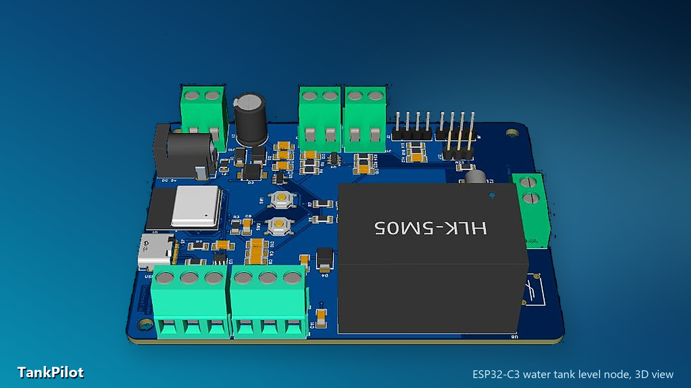
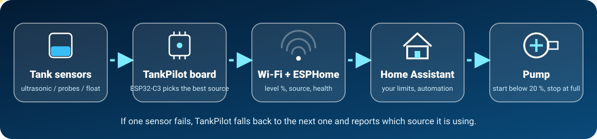
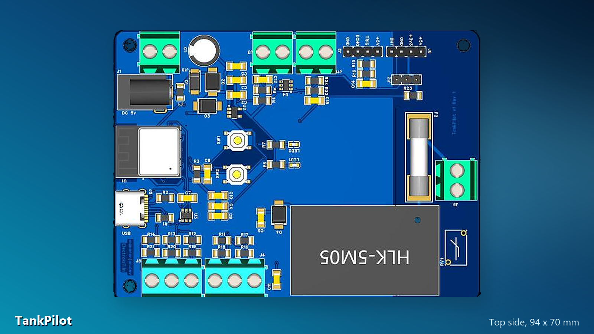
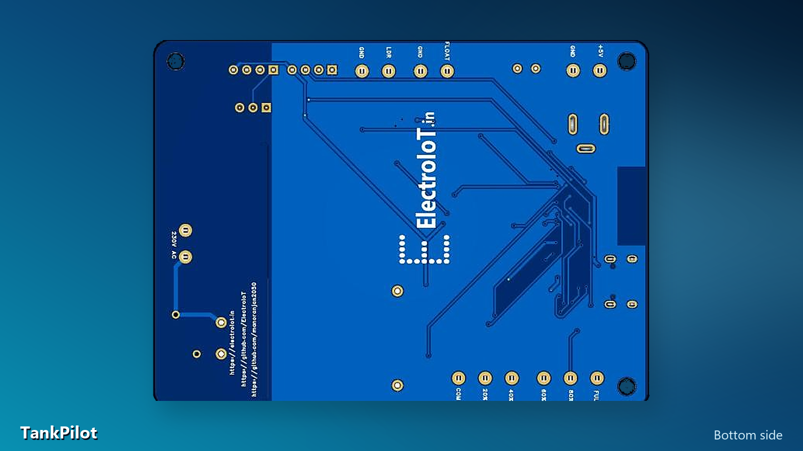

<div align="center">



# TankPilot

**Know your water tank level in percent, and let Home Assistant start the pump before the tank runs dry.**

One small ESP32-C3 board. Three kinds of level sensors. Automatic fallback. Open source.


[Features](#-features) | [How it works](#-how-it-works) | [Hardware](#-hardware-at-a-glance) | [Pinout](#-ports-and-pinout) | [BOM](#-bill-of-materials) | [Gerbers](#manufacturing-files) | [Firmware](#-firmware-and-home-assistant) | [Docs](#-documentation) | [Status](#-project-status)



</div>

> **Heads-up:** this is a design project. The schematic, PCB layout and routing are done (DRC clean), but **no board has been built or tested yet**, and the probe circuit and the firmware are still ideas to be proven on the bench. The repository name says ESP32-S3 because that is where the project started; the board uses an **ESP32-C3-MINI-1** module.

## Why TankPilot?

Float switches only say "full" or "empty". Ultrasonic sensors give a nice number but fail with steam, foam or a dirty sensor face. Probe kits are rugged and cheap but give steps. Most tank controllers lock you into one of them, with no smart-home link.

TankPilot puts all three on one open board. The ultrasonic sensor gives a smooth percentage, the stainless probes are the safety cross-check, and the float is the last resort. If one fails, the board keeps working with the next one and **tells you which source it is using**.

## Features

| | Feature | Details |
|---|---|---|
| 📏 | **Ultrasonic level** | Header for JSN-SR04T / HC-SR04 style 5 V sensors; the 5 V echo is divided to a safe 3.3 V |
| 🧪 | **5-level probe port** | COM + 5 stainless probes (20, 40, 60, 80 %, FULL) on two screw terminals, driven with **AC** through a capacitor so the probes do not corrode |
| 🔘 | **Float input** | Dry contact with pull-up, series resistor, filter capacitor and ESD protection for long cables |
| 🔁 | **Automatic fallback** | Ultrasonic fails: probes take over. Probes fouled: the float. The source is always reported |
| 🏠 | **Home Assistant ready** | ESPHome over Wi-Fi with encrypted API, OTA updates and a fallback hotspot |
| ⚡ | **Auto pump start** | A Home Assistant automation starts the pump below your limit (for example 20 %) and stops it at full |
| 🌡️ | **Light + climate** | LDR light sensor (analog) and DHT11 temperature / humidity |
| 🔌 | **3 power sources** | 5 V DC jack, 2-pin 5 V terminal, USB-C, or an optional on-board HLK-5M05 for 230 V AC |
| 🛡️ | **Protected** | 0.5 A PTC fuse, 5 V TVS, Schottky OR-ing, ESD arrays on USB and the float line, varistor + fuse on the 230 V option |
| 💾 | **Native USB-C** | Flash and read logs over USB: no USB-UART chip, EN and BOOT buttons on board |
| 📦 | **IP67 box ready** | 94 x 70 mm board sized for a 120 x 80 x 55 mm transparent IP67 enclosure |
| 🧰 | **Open and hackable** | Spare GPIO / 3.3 V / 5 V header, status LEDs, full design files and docs |

## How it works

<div align="center"></div>

1. **Measure.** The ESP32-C3 reads the ultrasonic distance, the five probes and the float, and checks every source for health.
2. **Decide the level.** It converts the best healthy source to 0-100 %, cross-checks it against the probes and sends level, source and alerts to Home Assistant.
3. **Act.** Home Assistant compares the level with your start and stop limits and presses the pump's Start or Stop switch. If tank data is stale, it never starts the pump automatically.

### Which sensor should I buy?

| | Ultrasonic (JSN-SR04T) | 5-level probes (stainless) | Float switch |
|---|---|---|---|
| Output | smooth 0-100 % | 5 steps: 20 / 40 / 60 / 80 / FULL | one level |
| Great for | level bar, trends | auto-start at a level, overflow stop | simple backup |
| Weak point | about 25 cm blind zone; steam, foam, dirty face | rods foul over time; needs 6 wires | one level only |
| Tip | mount on the lid, facing down | COM = longest rod; a 5-probe kit gives COM + 4 levels | use only as a dry contact |

For **auto-start at a fixed level** the probes are the safest main sensor. The board supports all three, so you can add the others later.

## Hardware at a glance

| Item | Details |
|---|---|
| Microcontroller | ESP32-C3-MINI-1-N4 (Wi-Fi 2.4 GHz, Bluetooth LE, 4 MB flash, PCB antenna) |
| Firmware | ESPHome (esp-idf), native API with encryption, OTA |
| Probe port | 2 x 3-pin 5.08 mm terminals, AC-coupled COM drive, 1 k series + 470 k pull-down per line |
| Ultrasonic port | 1x4 header: +5 V, TRIG, ECHO (5 V to 3.3 V divider), GND |
| Float port | 2-pin 5.08 mm terminal, 10 k pull-up, 1 k series, 100 nF filter, ESD |
| Extra sensors | LDR (2-pin terminal, ADC) and DHT11 (3-pin header) |
| Power in | 5 V DC jack, 5 V terminal, USB-C, optional HLK-5M05 (90-265 V AC) |
| 3.3 V | AP2112K LDO, 470 uF bulk capacitor on 5 V |
| PCB | 94 x 70 mm, 2 layers, 1.6 mm, 3 mounting holes, GND pours, antenna keep-out, isolation slot for the 230 V option |
| Enclosure | 120 x 80 x 55 mm transparent ABS IP67 box (about 96 x 75 mm free floor, 43 mm inside height) |
| Parts cost | **65 parts, about $9.84** with the 230 V option, **about $6.19 without it** (PCB, sensors and box not included) |

<div align="center">


</div>

## Ports and pinout

Pin order below is **as built** in the EasyEDA schematic / PCB.

| Ref | Port | Pins |
|---|---|---|
| J1 | DC jack 5.5/2.1 | tip = +5 V, sleeve = GND |
| J10 | 5 V terminal (2P) | 1 = GND, 2 = +5 V |
| J5 | USB-C | programming, logs, 5 V |
| J2 | Ultrasonic header (1x4) | 1 = GND, 2 = ECHO, 3 = TRIG, 4 = +5 V |
| J3 | Float switch (2P) | 1 = GND, 2 = float (either wire order) |
| J4 | Probes (3P) | 1 = 40 %, 2 = 20 %, 3 = COM |
| J8 | Probes (3P) | 1 = FULL, 2 = 80 %, 3 = 60 % |
| J11 | LDR (2P) | 1 = GND, 2 = LDR (either wire order) |
| J12 | DHT11 header (1x3) | 1 = GND, 2 = DATA, 3 = +3V3 (check your module's order) |
| J6 | Expansion (1x4, not fitted) | 1 = IO2 (DHT), 2 = GND, 3 = +3V3, 4 = +5 V |
| J9 | AC in (2P, option) | 1 = N, 2 = L (230 V, engineer review) |

### ESP32-C3 GPIO map

| GPIO | Net | Direction | Notes |
|---|---|---|---|
| 0 | `LDR` | in (ADC) | J11 via 1 k, 10 k pull-up, 100 nF |
| 1 | `PROBE_40` | in | probe line, 1 k series + 470 k pull-down |
| 2 | `DHT` | io | J12 DATA, 10 k pull-up (strapping pin, idles high) |
| 3 | `PROBE_60` | in | probe line |
| 4 | `PROBE_COM` | out | AC burst through C11 (1 uF) to the COM rod |
| 5 | `PROBE_80` | in | probe line |
| 6 | `PROBE_FULL` | in | probe line |
| 7 | `FLOAT1` | in | J3 float, 10 k pull-up |
| 8 | `LED_ST` | out | green status LED (strapping pin: LED only) |
| 9 | `BOOT / PAIR` | in | SW2 to GND (strapping pin) |
| 10 | `PROBE_20` | in | probe line |
| 18 / 19 | `USB D- / D+` | io | USB-C through the ESD part U3 |
| 20 | `US_ECHO` | in | J2 ECHO via 1 k / 2 k divider (RXD0) |
| 21 | `US_TRIG` | out | J2 TRIG (TXD0) |
| EN | `EN` | in | SW1 reset, 10 k pull-up, 100 nF |

Strapping pins: GPIO2 must be high at reset (the DHT11 idles high through its pull-up), GPIO8 drives only the status LED, GPIO9 is BOOT. For USB download mode hold BOOT while pressing EN.

### Power

```
 5 V DC jack J1 --PTC F1--TVS D1--D2 --\
 5 V terminal J10 ---------------------/
 USB-C VBUS J5 -------------------------D3 ----> +5V --> AP2112K --> +3V3 --> ESP32-C3
 HLK-5M05 (230 V option) ----------------D4 --/
```

The sources are combined with Schottky diodes, so the highest one wins and none can back-feed another. Because the IP67 box is sealed, use the **J10 terminal** for the 5 V supply; the DC jack and USB-C are for work with the lid open.

## Bill of materials

All parts are on LCSC. The cost below uses first-tier prices read in November 2026 and changes daily. Rows marked *(option)* belong to the optional 230 V block.

| | Pieces | Cost |
|---|---:|---:|
| **Everything** (with the 230 V option) | 65 | **$9.84** |
| **5 V version** (without the 230 V option) | 57 | **$6.19** |
| 230 V option only | 8 | $3.65 |

Downloads: [`tank-node-bom-v1.csv`](hardware/bom/tank-node-bom-v1.csv) | [`bom-table.md`](hardware/bom/bom-table.md) | interactive page with tick boxes: [`docs/bom.html`](docs/bom.html)

#### Sheet 1: Power (DC jack, 5 V terminal, USB-C, HLK option)

**5 V POWER (DC jack, USB, 3.3 V)**  
<sub>5 V from the DC jack J1 or the 2-pin screw terminal J10 (both through the PTC fuse + TVS), or USB-C, or the optional HLK module, OR-ed with Schottky diodes, then an AP2112K 3.3 V LDO.</sub>

| Ref | Qty | Function | Part | LCSC |
|---|---:|---|---|---|
| J1 | 1 | DC barrel jack 5.5/2.1 mm: external 5 V in | `DC-005-20A` | [C136744](https://www.lcsc.com/product-detail/C136744.html) |
| J10 | 1 | 5 V DC screw terminal 2P (+5 V, GND): external 5 V in | `KF128-5.08-2P-AA` | [C474952](https://www.lcsc.com/product-detail/C474952.html) |
| F1 | 1 | PTC fuse 0.5 A 6 V, 1206 | `1206L050YR` | [C163512](https://www.lcsc.com/product-detail/C163512.html) |
| D1 | 1 | TVS 5 V (SMAJ5.0A) across the supply | `SMAJ5.0A` | [C5121739](https://www.lcsc.com/product-detail/C5121739.html) |
| D2, D3 | 2 | Schottky OR-ing: DC jack to +5V / Schottky OR-ing: USB VBUS to +5V | `UMW SS34B` | [C2758511](https://www.lcsc.com/product-detail/C2758511.html) |
| C1 | 1 | 470 uF 16 V bulk on +5V | `ERG16V470M8X12` | [C47344174](https://www.lcsc.com/product-detail/C47344174.html) |
| U2 | 1 | AP2112K-3.3 LDO, SOT-25 | `AP2112K-3.3TRG1` | [C51118](https://www.lcsc.com/product-detail/C51118.html) |
| C2, C3 | 2 | 10 uF 1206 | `CL31A106KAHNNNE` | [C9807](https://www.lcsc.com/product-detail/C9807.html) |
| C5 | 1 | 100 nF 1206 on +5V | `CL31B104KBCNNNC` | [C24497](https://www.lcsc.com/product-detail/C24497.html) |

**HLK 230 V -> 5 V (OPTIONAL)**  
<sub>Optional mains supply: AC in terminal, fuse, varistor and the HLK-5M05 module. Leave all of these parts off if you power the board from a 5 V adapter.</sub>

| Ref | Qty | Function | Part | LCSC |
|---|---:|---|---|---|
| J9 | 1 | OPTIONAL AC in screw terminal 2P (230 V) *(option)* | `KF128-5.08-2P-AA` | [C474952](https://www.lcsc.com/product-detail/C474952.html) |
| F2 | 1 | OPTIONAL fuse 0.5 A slow-blow 5x20 (ships separately) *(option)* | `0218.500MXP` | [C142727](https://www.lcsc.com/product-detail/C142727.html) |
| F2H | 2 | OPTIONAL 5x20 fuse clips (2 pieces) *(option)* | `BLX-A XC-7` | [C3131](https://www.lcsc.com/product-detail/C3131.html) |
| RV1 | 1 | OPTIONAL varistor 560 V (10D561K) across L-N *(option)* | `10D561K` | [C2839517](https://www.lcsc.com/product-detail/C2839517.html) |
| U8 | 1 | OPTIONAL HLK-5M05 AC-DC 5 V 1 A module *(option)* | `HLK-5M05` | [C209907](https://www.lcsc.com/product-detail/C209907.html) |
| D4 | 1 | OPTIONAL Schottky OR-ing: HLK to +5V *(option)* | `UMW SS34B` | [C2758511](https://www.lcsc.com/product-detail/C2758511.html) |
| C6 | 1 | OPTIONAL 100 nF 1206 on the HLK output *(option)* | `CL31B104KBCNNNC` | [C24497](https://www.lcsc.com/product-detail/C24497.html) |

**USB-C PROGRAMMING**  
<sub>C165948 USB-C, native USB on GPIO18 / GPIO19, 5.1 k CC resistors, ESD part.</sub>

| Ref | Qty | Function | Part | LCSC |
|---|---:|---|---|---|
| J5 | 1 | USB-C 16-pin receptacle (programming and 5 V) | `TYPE-C-31-M-12` | [C165948](https://www.lcsc.com/product-detail/C165948.html) |
| U3 | 1 | USBLC6-2SC6 ESD on USB D+/D- | `USBLC6-2SC6` | [C7519](https://www.lcsc.com/product-detail/C7519.html) |
| R1, R2 | 2 | 5.1 k 1206 | `1206W4F5101T5E` | [C26033](https://www.lcsc.com/product-detail/C26033.html) |
| C7 | 1 | 100 nF 1206 on VBUS | `CL31B104KBCNNNC` | [C24497](https://www.lcsc.com/product-detail/C24497.html) |

#### Sheet 2: ESP32-C3 core

**ESP32-C3 CORE**  
<sub>ESP32-C3-MINI-1-N4 module, EN / BOOT buttons, status LEDs, decoupling, expansion header.</sub>

| Ref | Qty | Function | Part | LCSC |
|---|---:|---|---|---|
| U1 | 1 | ESP32-C3-MINI-1-N4 module | `ESP32-C3-MINI-1-N4` | [C2838502](https://www.lcsc.com/product-detail/C2838502.html) |
| SW1, SW2 | 2 | Reset button (EN) / BOOT / PAIR button (GPIO9) | `TS-1187A-B-A-B` | [C318884](https://www.lcsc.com/product-detail/C318884.html) |
| R3 | 1 | 10 k 1206, EN pull-up | `1206W4F1002T5E` | [C17902](https://www.lcsc.com/product-detail/C17902.html) |
| C8, C9, C10 | 3 | 100 nF 1206 | `CL31B104KBCNNNC` | [C24497](https://www.lcsc.com/product-detail/C24497.html) |
| C4 | 1 | 10 uF 1206, 3V3 at the module | `CL31A106KAHNNNE` | [C9807](https://www.lcsc.com/product-detail/C9807.html) |
| LED1 | 1 | Red LED: power (3.3 V) | `XL-1608SURC-04` | [C965798](https://www.lcsc.com/product-detail/C965798.html) |
| R6, R7 | 2 | 1 k 1206 | `1206W4F1001T5E` | [C4410](https://www.lcsc.com/product-detail/C4410.html) |
| LED2 | 1 | Green LED: status (GPIO8) | `19-217/GHC-YR1S2/6T` | [C2986059](https://www.lcsc.com/product-detail/C2986059.html) |
| J6 | 1 | OPTIONAL expansion header 1x4 (5V, 3V3, GND, IO2 shared with the DHT11 line) *(option)* | `PZ254V-11-04P` | [C2691448](https://www.lcsc.com/product-detail/C2691448.html) |

#### Sheet 3: Sensor ports (ultrasonic, float, probes, LDR, DHT11)

**ULTRASONIC PORT**  
<sub>J2 header for JSN-SR04T / HC-SR04: +5V, TRIG, ECHO (5 V to 3.3 V divider), GND.</sub>

| Ref | Qty | Function | Part | LCSC |
|---|---:|---|---|---|
| J2 | 1 | Ultrasonic sensor header 1x4 (JSN-SR04T / HC-SR04) | `PZ254V-11-04P` | [C2691448](https://www.lcsc.com/product-detail/C2691448.html) |
| R15 | 1 | 1 k 1206, ECHO series (divider top) | `1206W4F1001T5E` | [C4410](https://www.lcsc.com/product-detail/C4410.html) |
| R16 | 1 | 2 k 1206, ECHO divider to GND | `1206W4F2001T5E` | [C17944](https://www.lcsc.com/product-detail/C17944.html) |
| C14 | 1 | 100 nF 1206 on the sensor +5V | `CL31B104KBCNNNC` | [C24497](https://www.lcsc.com/product-detail/C24497.html) |

**FLOAT SWITCH PORTS**  
<sub>J3: one dry-contact float switch input, with pull-up, series resistor, filter capacitor and ESD (the second float input was dropped to free a GPIO for the DHT11).</sub>

| Ref | Qty | Function | Part | LCSC |
|---|---:|---|---|---|
| J3 | 1 | Float switch terminal 2P (dry contact) | `KF128-5.08-2P-AA` | [C474952](https://www.lcsc.com/product-detail/C474952.html) |
| R8 | 1 | 1 k 1206, FLOAT1 series | `1206W4F1001T5E` | [C4410](https://www.lcsc.com/product-detail/C4410.html) |
| R4 | 1 | 10 k 1206, FLOAT1 pull-up | `1206W4F1002T5E` | [C17902](https://www.lcsc.com/product-detail/C17902.html) |
| C12 | 1 | 100 nF 1206, FLOAT1 filter | `CL31B104KBCNNNC` | [C24497](https://www.lcsc.com/product-detail/C24497.html) |
| U4 | 1 | USBLC6-2SC6 ESD for the float line (second channel unused) | `USBLC6-2SC6` | [C7519](https://www.lcsc.com/product-detail/C7519.html) |

**PROBE PORT (COM + 5 LEVELS)**  
<sub>J4 + J8: COM (AC-coupled drive) and five level probes 20 / 40 / 60 / 80 / FULL, each with a series resistor and a pull-down.</sub>

| Ref | Qty | Function | Part | LCSC |
|---|---:|---|---|---|
| J4, J8 | 2 | Probe terminal 3P: COM / Probe terminal 3P: 60 % | `KF128-5.08-3P-AA` | [C474953](https://www.lcsc.com/product-detail/C474953.html) |
| C11 | 1 | 1 uF 1206 coupling capacitor on PROBE_COM (no DC in the water) | `CL31B105KBHNNNE` | [C1848](https://www.lcsc.com/product-detail/C1848.html) |
| R10, R11, R12, R13, R14 | 5 | 1 k 1206 | `1206W4F1001T5E` | [C4410](https://www.lcsc.com/product-detail/C4410.html) |
| R17, R18, R19, R20, R21 | 5 | 470 k 1206 | `1206W4F4703T5E` | [C17997](https://www.lcsc.com/product-detail/C17997.html) |

**EXTRA SENSORS (LDR light, DHT11)**  
<sub>J11 2-pin terminal for an LDR (light sensor) with a 10 k divider into the ADC pin GPIO0, and J12 3-pin header for a DHT11 temperature / humidity sensor on GPIO2 (strapping pin, must be high at reset: the DHT11 idles high with its 10 k pull-up) .</sub>

| Ref | Qty | Function | Part | LCSC |
|---|---:|---|---|---|
| J11 | 1 | LDR screw terminal 2P (light sensor on a cable) | `KF128-5.08-2P-AA` | [C474952](https://www.lcsc.com/product-detail/C474952.html) |
| R24 | 1 | 1 k 1206, LDR series | `1206W4F1001T5E` | [C4410](https://www.lcsc.com/product-detail/C4410.html) |
| R22, R23 | 2 | 10 k 1206 | `1206W4F1002T5E` | [C17902](https://www.lcsc.com/product-detail/C17902.html) |
| C15 | 1 | 100 nF 1206, LDR filter | `CL31B104KBCNNNC` | [C24497](https://www.lcsc.com/product-detail/C24497.html) |
| J12 | 1 | DHT11 header 1x3 (3V3, DATA, GND) | `PZ254V-11-03P` | [C492402](https://www.lcsc.com/product-detail/C492402.html) |

Not in the BOM: the PCB, sensors (JSN-SR04T, probe kit, float switch, LDR, DHT11), the enclosure and cable glands, and a 5 V supply. The fuse clips (F2H, C3131) are in the BOM but not yet drawn in the schematic; check that your F2 footprint matches the 5x20 fuse.

## PCB and enclosure

- 94 x 70 mm, 2 layers, 1.6 mm, standard 2-layer fab rules: default track 0.25 mm / clearance 0.2 mm, net classes for power, 230 V AC and USB.
- 63 parts, GND pours on both layers on the low-voltage side, antenna keep-out under the module end, isolation slot between the HLK module and the rest.
- DRC: **0 errors**. Mains tracks are 0.8 mm with live and neutral on different layers, but **must be reviewed by an engineer before any 230 V use**.
- Enclosure: 120 x 80 x 55 mm IP67 transparent ABS box. A 100 mm wide board would not fit; 94 x 70 mm does. Use cable glands for the sensor wires.

Floor plan, silkscreen blocks and X/Y tables: [`docs/pcb-floorplan.html`](docs/pcb-floorplan.html).

## Manufacturing files

Exported from EasyEDA Pro on 2026-11-10 (PCB with the RV1 varistor, the USB-C shell grounded and the final routing):

| File | What it is |
|---|---|
| [`hardware/gerber/Gerber_PCB1_2026-11-10.zip`](hardware/gerber/Gerber_PCB1_2026-11-10.zip) | Gerber + drill files (top, bottom, silkscreen, mask, paste, outline, PTH / NPTH drills) |
| [`hardware/assembly/BOM_Board1_PCB1_2026-11-10.csv`](hardware/assembly/BOM_Board1_PCB1_2026-11-10.csv) | EasyEDA BOM with LCSC part numbers (for assembly services) |
| [`hardware/assembly/PickAndPlace_PCB1_2026_11_10.csv`](hardware/assembly/PickAndPlace_PCB1_2026_11_10.csv) | pick-and-place (centroid) file: X, Y, rotation and side of every part |
| [`hardware/schematic/SCH_Schematic1_2026-11-10.pdf`](hardware/schematic/SCH_Schematic1_2026-11-10.pdf) | the 3-sheet schematic as PDF |

Notes: the boards are untested, so order a small batch first. Through-hole parts (screw terminals, DC jack, headers, HLK module, varistor) are hand-soldered. If you skip the 230 V option, leave off U8, F2, RV1, J9, D4 and C6. The fuse clips are not in this BOM.

## Firmware and Home Assistant

**Planned entities (ESPHome):** `Tank level %`, `Tank level source`, `Ultrasonic distance cm`, `Probe 20 / 40 / 60 / 80 / FULL`, `Float 1`, `Ultrasonic OK`, `Probes OK`, `Sensor mode` (Auto, Ultrasonic only, Probes only, Float only), `D_empty cm`, `D_full cm`.

**Auto-start logic (Home Assistant automation):**

- **Start** when `Tank level %` is below `start_below` (default 20 %), the data is fresh, the pump is off, a minimum off time has passed and no alarm is active.
- **Stop** at `stop_at` (default FULL) or when the float says full, and after a maximum run time (default 60 min).
- If the tank node is unavailable for more than 2 minutes, the pump is never started automatically and you get a notification.
- A `Tank auto mode` switch turns the automation on or off; the pump's own buttons keep working.

<details>
<summary>Example automation (untested sketch, adjust the entity names)</summary>

```yaml
automation:
  - alias: "Tank low - start pump"
    trigger:
      - platform: numeric_state
        entity_id: sensor.tank_level
        below: input_number.tank_start_below
    condition:
      - condition: state
        entity_id: input_boolean.tank_auto_mode
        state: "on"
      - condition: state
        entity_id: switch.pump_running
        state: "off"
    action:
      - service: switch.turn_on
        target:
          entity_id: switch.start_pump
```

</details>

<details>
<summary>ESPHome starter (untested sketch, pins follow the GPIO map)</summary>

```yaml
esphome:
  name: tankpilot
esp32:
  board: esp32-c3-devkitm-1
  framework:
    type: esp-idf
logger:
api:
  encryption:
    key: !secret api_key
ota:
  platform: esphome
wifi:
  ssid: !secret wifi_ssid
  password: !secret wifi_password
  ap:
sensor:
  - platform: ultrasonic
    trigger_pin: GPIO21
    echo_pin: GPIO20
    name: "Ultrasonic distance"
    update_interval: 5s
  - platform: adc
    pin: GPIO0
    name: "Light (LDR)"
  - platform: dht
    pin: GPIO2
    model: DHT11
    temperature: {name: "Temperature"}
    humidity: {name: "Humidity"}
binary_sensor:
  - platform: gpio
    pin: {number: GPIO7, mode: INPUT_PULLUP, inverted: true}
    name: "Float 1"
```

The probe-burst measurement (AC drive on GPIO4, reading GPIO10, 1, 3, 5, 6) needs a small custom component that is still to be written and bench-tested.

</details>

## Documentation

GitHub shows HTML files as source. Open them locally, or enable GitHub Pages for the `docs/` folder to read them online.

| Page | What is in it |
|---|---|
| [`docs/project-page.html`](docs/project-page.html) | the blog / website page for this project |
| [`docs/bom.html`](docs/bom.html) | BOM with tick boxes, search and copy-all C-numbers |
| [`docs/wiring-by-section.html`](docs/wiring-by-section.html) | system map, external wiring, pin-to-net diagrams |
| [`docs/schematic-sections.html`](docs/schematic-sections.html) | three schematic sheets, parts tables, pin guides for U1 and the ESD chips |
| [`docs/pcb-floorplan.html`](docs/pcb-floorplan.html) | floor plan, X/Y tables, enclosure fit |
| [`PLAN.md`](PLAN.md) | the full plan: MCU advice, circuits, level logic, open questions |

Images for posts (hero, square, story, infographics, 3D renders): [`docs/images/social/`](docs/images/social/).

## Project status

- [x] Concept, parts selection and LCSC BOM
- [x] Schematic (3 sheets) in EasyEDA
- [x] PCB layout, rules, routing, DRC clean
- [x] 3D renders, documentation, project page
- [ ] Order a small batch of boards and check footprints and pin orders
- [ ] Bench-test and tune the probe circuit
- [ ] Write the ESPHome firmware (including the probe-burst component)
- [ ] Home Assistant dashboard and automation
- [ ] Optional: engineer review of the 230 V section

**Known open points:** fuse clips for F2 are not in the schematic; the mounting hole at (4, 66) mm is close to J10 (use a low-profile screw or a plastic standoff); GPIO8 status LED can matter for USB download mode; the JSN-SR04T trigger level and several part data sheets are not read yet (see [`PLAN.md`](PLAN.md), section 11).

## Safety

The optional HLK-5M05 section connects the board to **230 V AC**, and a water tank is a wet place. Build the 5 V version first, use an IP65 or better box, keep mains wiring away from the probe cables, and have a qualified person review anything that touches mains. Never connect a float switch contact to the pump or to mains on the same wires as the sensor input.

## Repository layout

```
docs/                 HTML guides (BOM, wiring, schematic, PCB) and images
  images/social/      post graphics and 3D renders
  images/renders/     EasyEDA 3D screenshots used for the graphics
hardware/bom/         BOM as CSV and Markdown
hardware/gerber/      Gerber + drill zip
hardware/assembly/    EasyEDA BOM and pick-and-place CSV
hardware/schematic/   schematic PDF
tools/                Python generators for the BOM, docs, SVGs, images and this README
PLAN.md               full design plan
```

Regenerate: `python tools/gen_docs.py`, `python tools/gen_svgs.py`, `python tools/make_images.py`, `python tools/gen_readme.py`.

## License

MIT, see [`LICENSE`](LICENSE). Datasheets are not included (copyrighted); see the part links above.

<div align="center">

Made by **ElectroIoT** | [electroiot.in](https://electroiot.in)

</div>
